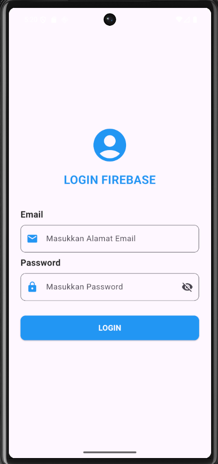
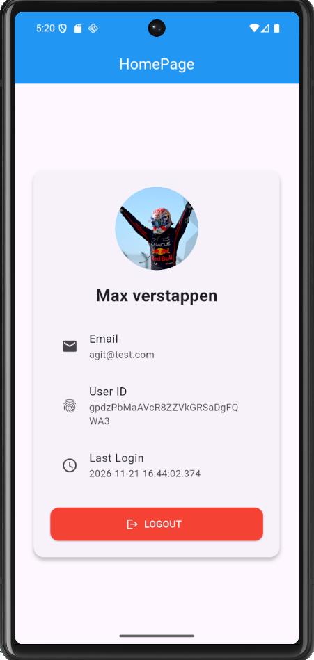

# Tugas WEEK 8

Profile App merupakan aplikasi mobile sederhana yang dibuat menggunakan Flutter dan Firebase. Aplikasi ini memiliki fitur login menggunakan email dan password yang terhubung dengan Firebase Authentication.

Setelah berhasil login, pengguna akan diarahkan ke halaman Home yang menampilkan informasi profil seperti nama, foto profil, email, User ID, dan waktu terakhir login.

Aplikasi ini juga dilengkapi dengan fitur validasi email dan password, tampilkan/sembunyikan password, serta logout.

## Teknologi yang Digunakan

- Flutter
- Dart
- Firebase Core
- Firebase Authentication

## Fitur Aplikasi

- Login menggunakan Email dan Password.
- Menampilkan nama dan foto profil pengguna.
- Menampilkan email dan User ID.
- Menampilkan waktu terakhir login.
- Logout dari akun.

## Tampilan Aplikasi
### 1. Halaman Login

### 2. Halaman Home Page

